# html-artifact

A Claude Code plugin for **reviewable, interactive HTML documents**: RFCs, design docs, plans, code reviews, postmortems, reports, decision memos, and one-off tools such as test plans, data explorers, mind maps and comparison matrices.

<picture>
  <source media="(prefers-color-scheme: dark)" srcset="docs/screenshots/tour-dark.webp">
  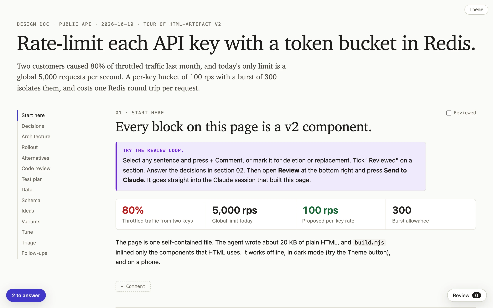
</picture>

This is the first screen of [`examples/tour.src.html`](plugins/html-artifact/examples/tour.src.html), a design doc that uses every component except the slide deck. To try it, clone the repo and open `plugins/html-artifact/examples/tour.example.html` in a browser. The page needs no server. The [gallery](#gallery) below shows each component.

Claude writes content and plain HTML markup. A build script inlines prebuilt components, so every page comes out as one self-contained file with no network, no dependencies and no build pipeline. The file includes:

- light and dark themes, and a layout that works on a phone;
- a review kit: reviewed checkboxes, comments, text highlights that survive edits, quick labels, and delete/replace/general comments;
- **Send to Claude**, which posts the whole review back into the running session.

## Install

```text
/plugin marketplace add aasimsani/html-artifact
/plugin install html-artifact@html-artifact
```

Ask for "an RFC for X", "review this PR as a page", "write up the outage" or "a test plan for this release", and the skill triggers. It stays out of the way for short answers and code-only requests.

## How it works

1. **Route.** The skill maps each piece of information to the simplest component for its shape: events go on a timeline, options into a comparison, a code change into an annotated diff.
2. **Write `<name>.src.html`** using the markup in `references/components.md`, following the per-type spine in `references/types/`.
3. **Build.** `scripts/build.mjs` lints the source, fills `pre[data-src]` code blocks from the repo, draws text diagrams as SVG, then detects which components the markup uses and inlines only those.
4. **Refine once.** The skill asks whether each section is the fastest way to understand its information. If not, it restructures the section as a Minto pyramid: the answer first, the visual before the prose, and the detail on demand.
5. **Verify.** `scripts/verify.mjs` drives the system Chrome with no npm dependency. It checks for console errors, external requests, dark mode, overflow at 400px, text under 12px, credential-shaped strings, and that text selection opens the comment helper.
6. **Iterate.** The reader comments, answers decision blocks and edits interactive blocks, then presses Send to Claude. The agent edits the source and rebuilds. Highlights re-anchor, and changed sections show a word diff.

## Components

| Family | Markup |
|---|---|
| shell | page layout, TOC, theme toggle, table style, `HA.register` for interactive state |
| review | reviewed checkboxes, comments, highlights, quick labels, tray, exports, Send to Claude, share links, version diff |
| content | `aside.callout`, `dl.stats`, `div.bar`, `span.claim`, `ol.chain`, `ol.ranked`, `ul.checklist` |
| timeline | `ol.timeline`, `ol.stepper`, `div.roadmap` |
| diagram | `figure.flow`, `figure.diagram` (a text diagram placed on a grid, or hand-drawn SVG; arrowheads, Copy SVG, click-to-expand) |
| mock | `figure.mock`: real HTML in a browser, phone or terminal frame, with numbered pins |
| table | `table[data-sortable]`, `table.matrix` |
| code | syntax colours, `pre[data-src]` filled from the repo, `pre.diff`, `div.annotated`, `table.findings`, `ol.risk` |
| ask | `div.ask` decision blocks, `[data-if]` consequences, an "N to answer" button |
| testplan, explorer, erd, mindmap, variants, playground, deck, editor | interactive artifact types, each with a reference in `references/types/` |

### Gallery

Every image is a crop of the tour example, except the slide. Click an image to see it at full size. `node docs/shots.mjs` captures them again after a component or an example changes.

<table>
<tr>
<td width="50%" valign="top">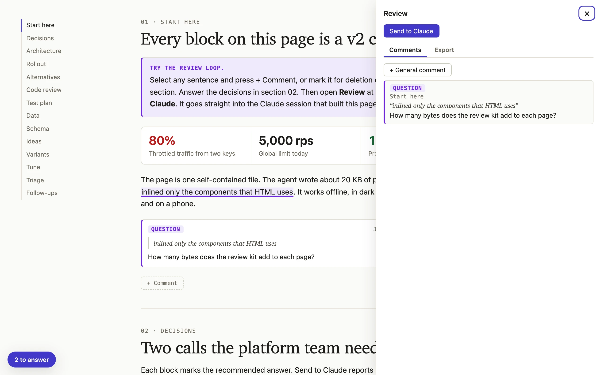<br><b>review</b><br>The reader comments on selected text. The drawer lists every comment and sends the review to Claude.</td>
<td width="50%" valign="top">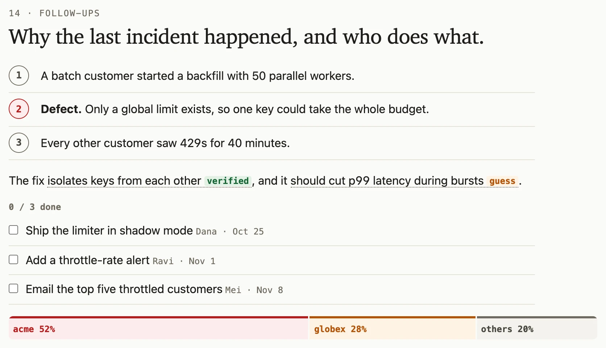<br><b>content</b><br><code>ol.chain</code>, <code>span.claim</code>, <code>ul.checklist</code> and <code>div.bar</code> show a cause, how sure a claim is, who does what and a share. The first screenshot has <code>aside.callout</code> and <code>dl.stats</code>.</td>
</tr>
<tr>
<td width="50%" valign="top">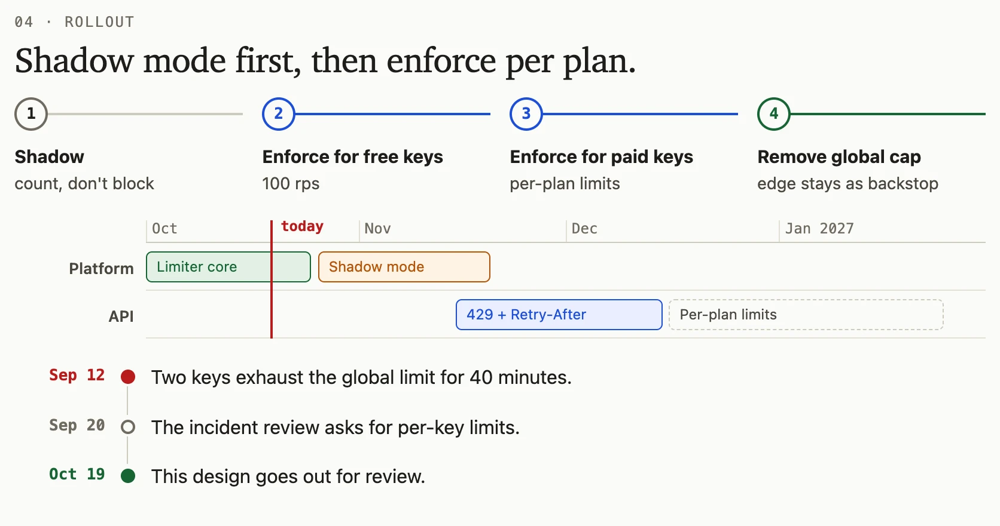<br><b>timeline</b><br><code>ol.stepper</code>, <code>div.roadmap</code> and <code>ol.timeline</code> show steps, a plan across months and events in time.</td>
<td width="50%" valign="top">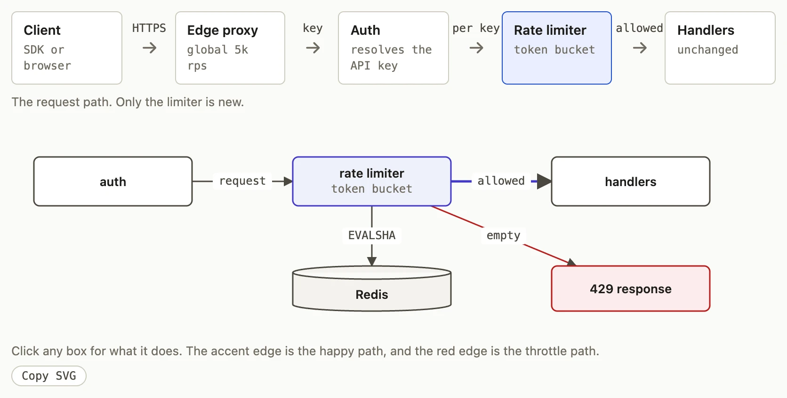<br><b>diagram</b><br><code>figure.flow</code> draws a straight path. <code>figure.diagram</code> draws a text diagram on a grid, and a click on a box opens its detail.</td>
</tr>
<tr>
<td width="50%" valign="top">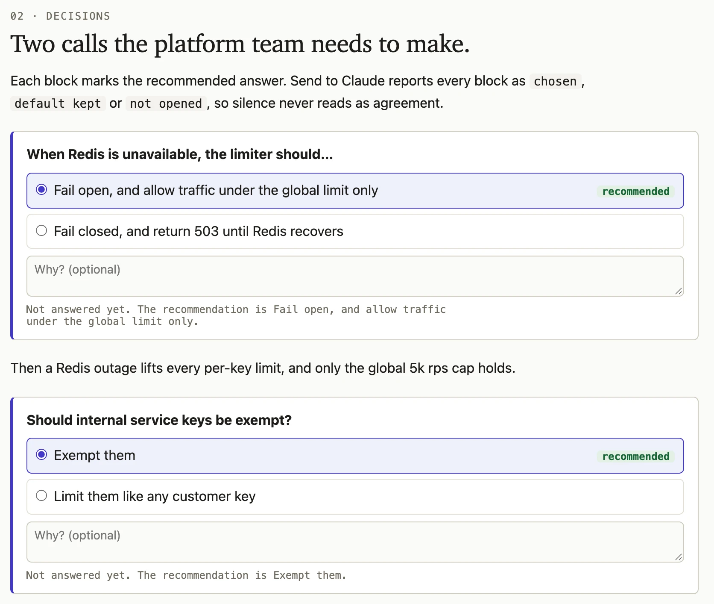<br><b>ask</b><br><code>div.ask</code> asks for a decision and marks the recommended answer. A <code>data-if</code> line says what the chosen answer changes.</td>
<td width="50%" valign="top">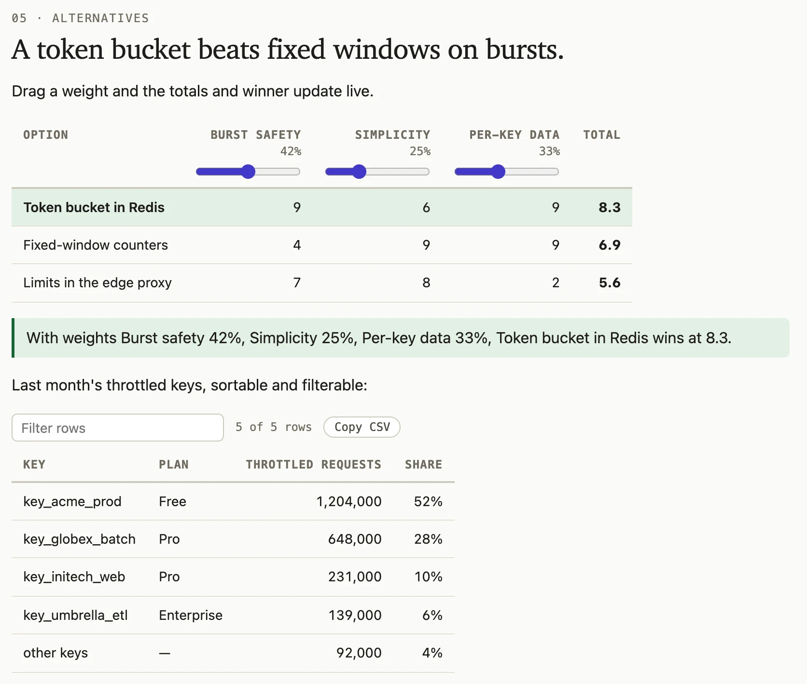<br><b>table</b><br><code>table.matrix</code> scores options against weights that the reader drags. <code>table[data-sortable]</code> sorts and filters rows.</td>
</tr>
<tr>
<td width="50%" valign="top">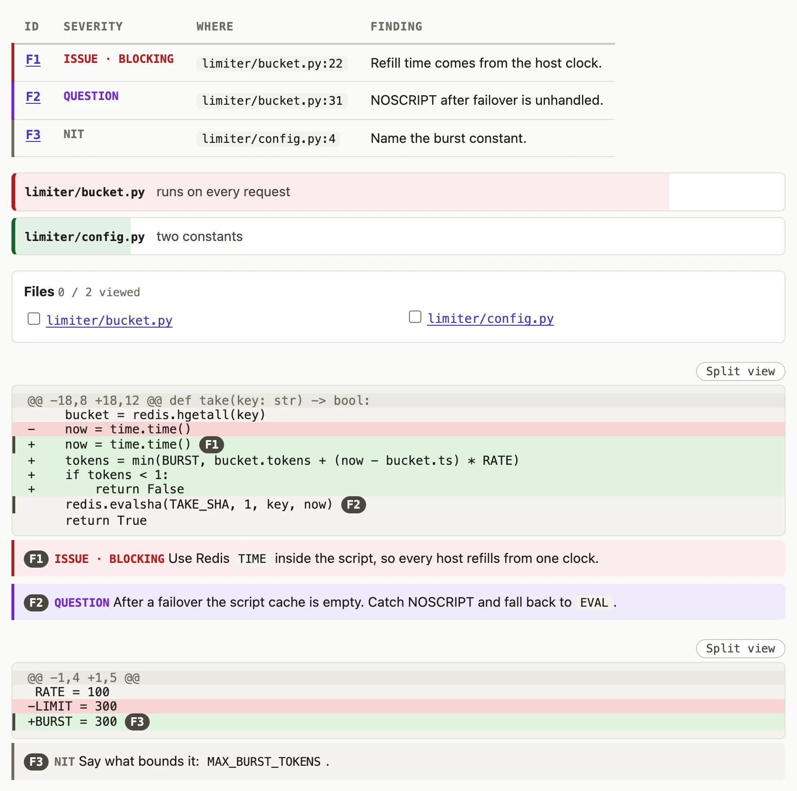<br><b>code</b><br><code>table.findings</code>, <code>ol.risk</code> and <code>pre.diff</code> with margin notes make a code review.</td>
<td width="50%" valign="top">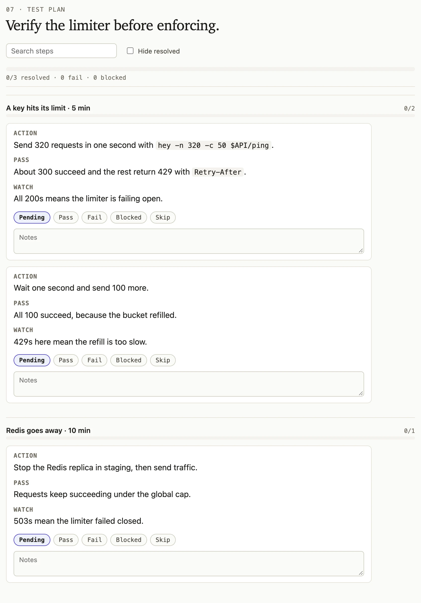<br><b>testplan</b><br><code>div.testplan</code> holds steps that a tester marks as pass, fail, blocked or skipped.</td>
</tr>
<tr>
<td width="50%" valign="top">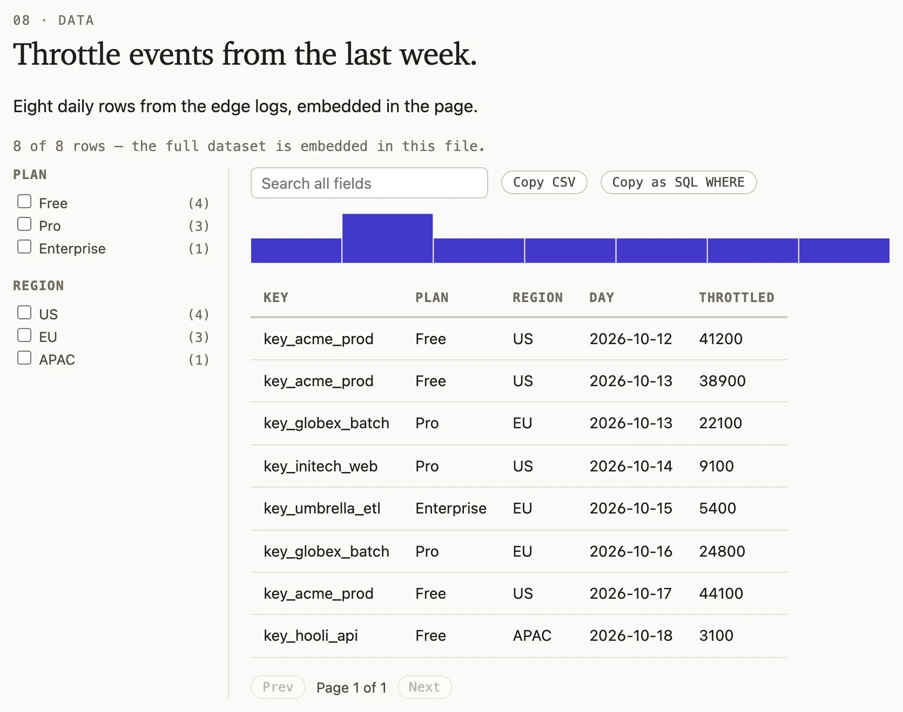<br><b>explorer</b><br><code>div.explorer</code> filters and searches a dataset that is embedded in the page.</td>
<td width="50%" valign="top">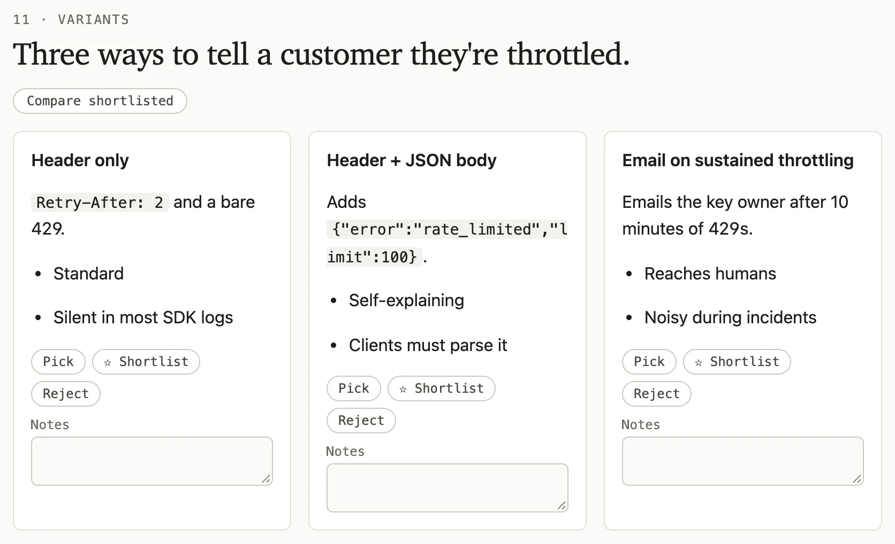<br><b>variants</b><br><code>div.variants</code> puts alternatives side by side to pick, shortlist or reject.</td>
</tr>
<tr>
<td width="50%" valign="top">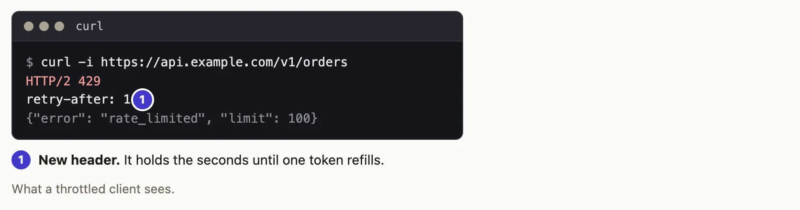<br><b>mock</b><br><code>figure.mock</code> shows real HTML in a browser, phone or terminal frame, with numbered pins.</td>
<td width="50%" valign="top">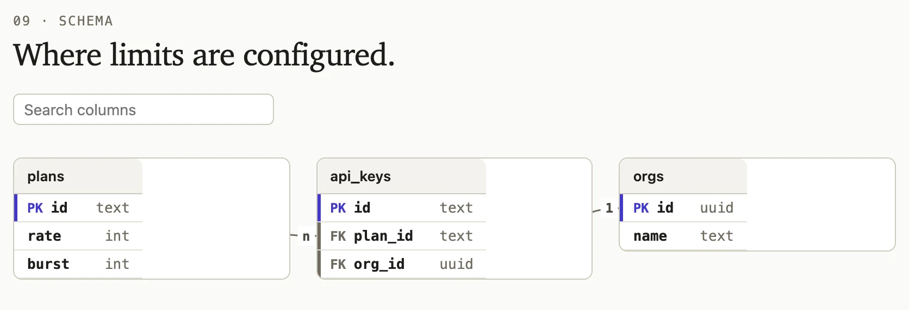<br><b>erd</b><br><code>div.erd</code> draws a database schema with its keys and relations.</td>
</tr>
<tr>
<td width="50%" valign="top">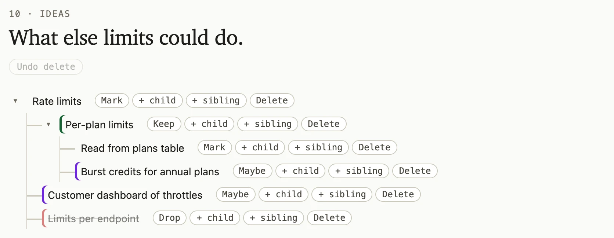<br><b>mindmap</b><br><code>ul.mindmap</code> is an idea tree that the reader grows, marks and prunes.</td>
<td width="50%" valign="top">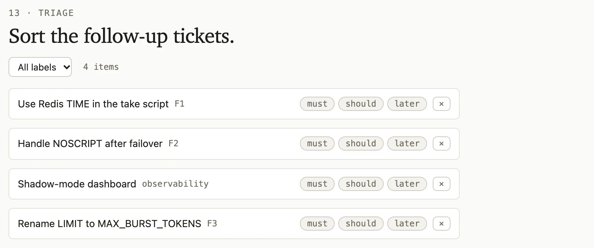<br><b>editor</b><br><code>ol.editor-list</code> is a list to triage, reorder and label.</td>
</tr>
<tr>
<td width="50%" valign="top">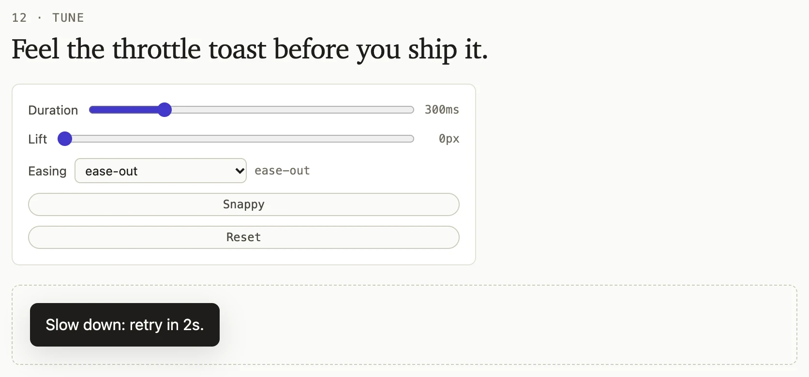<br><b>playground</b><br><code>form.playground</code> ties sliders to CSS variables, so the reader feels a parameter before it ships.</td>
<td width="50%" valign="top">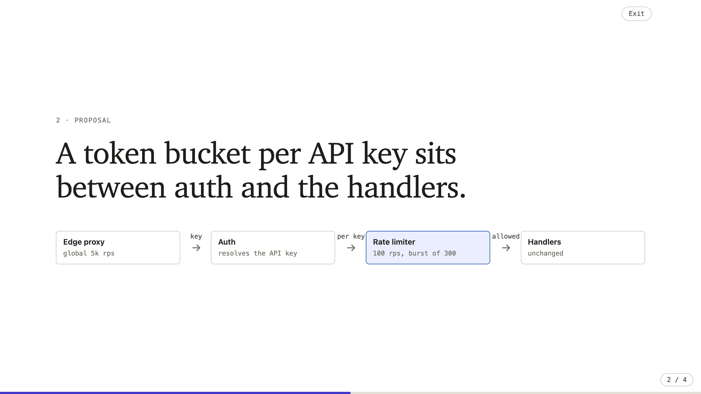<br><b>deck</b><br><code>body.deck</code> presents each section as a slide, with speaker notes. This slide is from <code>examples/deck.src.html</code>.</td>
</tr>
</table>

## Layout

```text
.claude-plugin/marketplace.json
plugins/html-artifact/
├── .claude-plugin/plugin.json
├── skills/html-artifact/
│   ├── SKILL.md                 # router, loop, refinement pass
│   ├── components/              # <name>.css / <name>.js, inlined by build.mjs
│   ├── references/              # components.md, types/*.md, rules/*.md
│   └── scripts/                 # build.mjs, lint.mjs, diagram.mjs, verify.mjs, cdp.mjs, receiver.mjs, listen.sh
├── examples/                    # tour and deck: every component, as source and as built pages
├── tests/                       # node --test tests/*.test.mjs (headless Chrome)
└── evals/                       # claude plugin eval: trigger and structure checks
docs/                            # README screenshots, and shots.mjs, which captures them
bench/                           # quality and cost comparison against other skills
research/                        # competitor survey, feature list, plan
```

## Tests

```bash
cd plugins/html-artifact
node --test tests/*.test.mjs          # component tests; needs Node ≥ 22 and Google Chrome
claude plugin eval . --allow-tools Write Edit Bash   # trigger evals, billed to your account
```

[`plugins/html-artifact/evals/README.md`](plugins/html-artifact/evals/README.md) gives the full eval command, explains the scores and logs every run.

## Credits

- The diagram, timeline, checklist, matrix, code-review and redaction rules are adapted from [f-labs-io/agent-html-skills](https://github.com/f-labs-io/agent-html-skills) (MIT). The local listener for Send to Claude follows its design.
- The trigger discipline, chart rules, style bans and the headless verify pass are adapted from [dogum/html-artifacts](https://github.com/dogum/html-artifacts) (Apache-2.0).
- The annotation types, quick labels, decision blocks and share links take their ideas from [backnotprop/plannotator](https://github.com/backnotprop/plannotator) and [nicobailon/visual-explainer](https://github.com/nicobailon/visual-explainer).
- The source lint, code filled from the repo, text diagrams on a grid, mockups with pins and the "to answer" button take their ideas from the html-plan plugin in [anthropics/claude-plugins-community](https://github.com/anthropics/claude-plugins-community).
- The original methodology comes from [thariqs.github.io/html-effectiveness](https://thariqs.github.io/html-effectiveness/).
